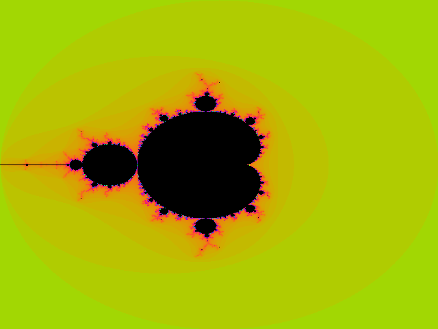

# Programmation concurrente


TP du cours de **Programmation concurrente** à **CPE Lyon**
(4IRC, 2025/2026). Le dépôt rassemble les treize séances de TP numérotées
(TP 1–12 et TP 14) ainsi que le TP sur le pipeline graphique, implémentés en C11
sous Linux/POSIX.

La progression suit le cours : d'une remise à niveau en C et des structures de
données classiques à la création de processus (`fork`, `exec`, `wait`), aux
tuyaux anonymes, aux signaux, aux sémaphores System V et à la mémoire partagée,
puis aux threads POSIX, aux barrières et à un pipeline de rendu logiciel complet
en plusieurs étapes.

> Les énoncés des exercices sont du matériel de cours de CPE Lyon. Ce dépôt
> contient les implémentations, les tests, les mesures et les réponses écrites.

---

## Sommaire

- [Aperçu](#aperçu)
- [Points forts](#points-forts)
- [Galerie](#galerie)
- [Démarrage rapide](#démarrage-rapide)
- [Structure du dépôt](#structure-du-dépôt)
- [Les séances](#les-séances)
- [Tests](#tests)
- [Concepts abordés](#concepts-abordés)
- [Documentation](#documentation)
- [Crédits](#crédits)
- [Licence](#licence)

---

## Aperçu

| # | Séance | Livrables principaux |
|---|---|---|
| 1 | **Remise à niveau en C** | factorisation en nombres premiers, suite look-and-say, intersection de droites, tri par insertion |
| 2 | **Tas** | tas-min en tableau, insertion, extraction, tri par tas, affichage arborescent ASCII |
| 3 | **Image et automate** | flou par convolution PPM, trois automates de digicode |
| 4 | **Arguments et `fork`** | `miroir`, `moyenne`, arbre de processus créé par fork, `wait`, enfants ordonnés |
| 5 | **`fork` et `exec`** | commandes concurrentes/successives, workers bornés pour miniatures et téléchargements, `make` parallèle |
| 6 | **Tuyaux anonymes** | jeu de devinette de nombres, redirections shell, filtre à quatre processus |
| 7 | **Tuyaux, suite** | anneau de processus recherchant un maximum, calculatrice à base de tuyaux |
| 8 | **Sémaphores** | précédence, rendez-vous à deux et trois processus, rendez-vous 1 vers 2 |
| 9 | **Signaux** | interception, ignorance, arrêt propre, `SIGKILL`, `SIGUSR1/2`, délai d'expiration |
| 10 | **Mémoire partagée** | rendez-vous à N voies, producteur/consommateur borné, échange de valeurs |
| 11 | **Applications de mémoire partagée** | calculatrice multi-serveurs, traitement d'images parallèle |
| 12 | **Threads** | rendez-vous avec et sans barrières, producteur/consommateur, échange, Mandelbrot |
| 14 | **Threads, suite** | gestionnaire de ressources à billes avec contrôleur, estimation de pi par Monte-Carlo |
| — | **Pipeline graphique** | pipeline triangle → rastérisation → shader synchronisé par barrières |

---

## Points forts

- **Chaque séance est exécutable** : chaque répertoire possède son propre
  `Makefile` et un court README ; le `make` de la racine les compile tous.
- **La sûreté des processus et des threads est testée**, pas seulement
  supposée : la suite vérifie l'ordre FIFO, le parallélisme borné, la sémantique
  des barrières, la gestion des signaux, le contenu de la mémoire partagée et
  l'absence de processus zombies.
- **Aucune attente active** dans le code de synchronisation : des sémaphores
  bloquants, des variables de condition et des barrières sont utilisés partout.
- **Un vrai moteur de rendu logiciel** : le TP pipeline génère une image PPM à
  partir d'une scène 3D procédurale avec un producteur de triangles, plusieurs
  rastériseurs et plusieurs shaders, synchronisés par une barrière à chaque
  changement de couleur.
- **Les avertissements sont des erreurs** en CI : `-Wall -Wextra -Werror` sur
  Ubuntu avec GCC.
- **131 tests d'intégration** pilotent de vrais processus et threads : signaux,
  tuyaux, sémaphores, mémoire partagée, barrières, images et le moteur de rendu
  complet.

---

## Galerie

| Pipeline graphique logiciel | Mandelbrot multithreadé |
|---|---|
|  |  |

Les deux images sont générées par les programmes de ce dépôt. L'image du
pipeline est produite par `pipeline/bin/pipeline` (scène de tore, barrières de
bandes de couleur) ; la fractale est produite par `tp12/bin/fractale` avec
quatre threads.

---

## Démarrage rapide

Prérequis : un système POSIX (Linux, WSL, macOS), `gcc` ou `clang`, `make`,
Python 3 et `pytest`. ImageMagick et `wget` ne sont nécessaires que pour le TP 5.

```bash
git clone https://github.com/ManuelDavid69/Concurrent-Programming.git
cd Concurrent-Programming

make                 # compiler toutes les séances
make check           # recompiler avec -Werror
python3 -m pytest    # tests d’intégration
```

Compiler et exécuter une séance :

```bash
make -C tp07
./tp07/bin/greater 6
```

Certains TP nécessitent d'abord la création de ressources partagées :

```bash
make -C tp08
./tp08/bin/init
./tp08/bin/first & ./tp08/bin/second
./tp08/bin/clean
```

---

## Structure du dépôt

```
common/          gestion des erreurs, images PPM, utilitaires IPC System V
tp01/            remise à niveau en C
tp02/            tas et tri par tas
tp03/            flou PPM et automates de digicode
tp04/            arguments, fork, wait, arbres de processus
tp05/            fork/exec, parallélisme borné, mini make
tp06/            tuyaux anonymes et redirections
tp07/            anneau de processus et calculatrice à tuyaux
tp08/            sémaphores System V
tp09/            signaux
tp10/            mémoire partagée System V
tp11/            calculatrice en mémoire partagée et traitement d’images
tp12/            threads POSIX
tp14/            gestionnaire de ressources par threads et pi par Monte-Carlo
pipeline/        pipeline graphique logiciel multi-thread
docs/            un document détaillé par séance
tests/           suite de tests d’intégration pytest
```

Chaque répertoire `tpXX/` contient ses sources, un `Makefile`, un court
`README.md` et un répertoire `bin/` créé par la compilation (ignoré par Git).

---

## Les séances

### 1. Remise à niveau en C

Factorisation en nombres premiers avec une recherche optimisée du plus petit
diviseur, la suite look-and-say, l'intersection de deux droites avec tous les cas
dégénérés (parallèles, confondues, verticales) et le tri par insertion.

### 2. Tas

Implémentation en tableau d'un tas-min (`left = 2i + 1`, `right = 2i + 2`), avec
insertion par remontée (sift up), extraction par descente (sift down), tri par
tas, un vérificateur de validité et trois formats d'affichage dont un arbre
ASCII.

### 3. Image et automate

Un lecteur/écrivain PPM et un flou moyen 3×3 utilisant la stratégie de *kernel
crop* sur les bords. Trois automates de digicode : `5742`, `5551` (chiffre
répété) et `8267B` avec validation par `A`/`B`.

### 4. Arguments et `fork`

Inversion de chaînes et moyenne de notes avec validation stricte ; un `fork`
dans une boucle à trois itérations sans `if` ; un père qui attend N enfants et
rapporte leurs codes de sortie ; quatre enfants affichant `1..200`, d'abord
concurremment puis dans un ordre garanti via un tuyau de jeton.

### 5. `fork` et `exec`

`du`, `ls` et `ps` lancés simultanément ou successivement ; miniatures avec au
plus huit processus `convert` ; téléchargements avec au plus quatre processus
`wget` ; un mini `make` qui compile les sources en parallèle et ne les lie que si
toutes les compilations ont réussi.

### 6. Tuyaux anonymes

Un jeu de devinette de nombres via deux tuyaux ; `wc < /etc/passwd`, `cut | tr`
et le pipeline complet `cut | sed | sort > users` ; un filtre pair/impair à
quatre processus avec un générateur, un répartiteur et deux additionneurs.

### 7. Tuyaux, suite

Un anneau de N processus où chaque processus transmet la plus grande valeur vue
jusqu'ici, et une calculatrice avec un tuyau de requêtes et un tuyau de réponses
par client.

### 8. Sémaphores

Programmes `init`/`clean` pour l'ensemble de sémaphores System V ; précédence
stricte entre deux processus indépendants ; rendez-vous pour deux et trois
processus ; et le rendez-vous 1 émetteur/2 récepteurs avec compteurs partagés.

### 9. Signaux

Sept programmes couvrant l'interception de `SIGINT`, `SIG_IGN`, un indicateur
d'arrêt propre, `SIGKILL` du père vers l'enfant, les signaux de terminal hérités,
la communication `SIGUSR1`/`SIGUSR2` et un délai d'expiration de cinq secondes en
entrée avec `SIGALRM`.

### 10. Mémoire partagée

Une barrière réutilisable à N voies construite à partir d'un mutex, d'un compteur
et de deux tourniquets ; un producteur/consommateur FIFO borné avec plusieurs
producteurs et consommateurs ; et l'algorithme d'échange de valeurs à trois
processus (P0, P1, P2).

### 11. Applications de mémoire partagée

Une calculatrice arithmétique multi-serveurs avec des emplacements de résultats
par client, et un service de traitement d'images parallèle où les workers
extraient des noms de fichiers d'une file partagée à cinq emplacements et
écrivent des images PPM floues.

### 12. Threads

Rendez-vous pour N threads implémenté avec un mutex/variable de condition et avec
`pthread_barrier_t` ; un producteur/consommateur borné ; un échange à trois
threads ; et un moteur de rendu Mandelbrot multithreadé.

### 14. Threads, suite

Un gestionnaire de billes : N workers demandent, utilisent et rendent des billes,
tandis qu'un thread contrôleur vérifie continuellement l'invariant
`0 <= available <= max`. Une estimation de pi par Monte-Carlo mono-thread et
multi-thread, avec une comparaison des temps.

### Pipeline graphique

Un tore 3D procédural est découpé en triangles par un producteur, rastérisé par
plusieurs threads en fragments, puis ombré par plusieurs threads en une image.
Une barrière synchronise toutes les étapes à chaque changement de couleur de la
scène, ce qui supprime le déchirement (tearing) visible sans synchronisation.

---

## Tests

```bash
python3 -m pytest -q
```

La suite compile le projet une fois, puis exécute les binaires. Elle couvre :

- les algorithmes déterministes et les cas limites (TP 1–3) ;
- les arbres de processus, les codes de sortie, l'ordonnancement et le
  parallélisme borné (TP 4–7) ;
- la précédence des sémaphores, les rendez-vous, la FIFO et la vérification des
  invariants (TP 8, 10) ;
- la livraison des signaux, le délai d'expiration et l'arrêt propre (TP 9) ;
- la requête/réponse multi-serveurs et les sorties d'images (TP 11) ;
- le rendez-vous de threads, le producteur/consommateur et les images Mandelbrot
  (TP 12, 14) ;
- le pipeline graphique complet avec un et plusieurs workers.

Les tests nécessitant des outils optionnels (`convert`, `wget`) sont ignorés
lorsque ces outils sont absents.

---

## Concepts abordés

| Concept | Où |
|---|---|
| Tableaux dynamiques, tri, cas limites numériques | TP 1 |
| Tas binaires, insertion/extraction en `O(log n)`, tri par tas | TP 2 |
| Format PPM, convolution, automates à états finis | TP 3 |
| `fork`, `wait`, `waitpid`, arbres de processus, codes de sortie | TP 4 |
| `execvp`, `dup2`, concurrence bornée, tuyaux pour l'ordonnancement | TP 5–6 |
| Tuyaux anonymes, `PIPE_BUF`, lectures/écritures partielles | TP 6–7 |
| Sémaphores System V (`semget`, `semop`, `semctl`) | TP 8 |
| Signaux (`sigaction`, `SIGALRM`, `kill`, `pause`) | TP 9 |
| Mémoire partagée System V (`shmget`, `shmat`, `shmdt`) | TP 10–11 |
| Threads POSIX, mutex, variables de condition, barrières | TP 12, 14 |
| Producteur/consommateur, rendez-vous, moniteurs, invariants | TP 8–14 |
| Rastérisation logicielle et synchronisation de pipeline | Pipeline |

---

## Documentation

Chaque séance dispose d'une description détaillée dans [`docs/`](docs/) :

| Séance | Document |
|---|---|
| 1 | [Remise à niveau en C](docs/TP01-c-refresher.md) |
| 2 | [Tas et tri par tas](docs/TP02-heap.md) |
| 3 | [Image et automate](docs/TP03-image-state-machine.md) |
| 4 | [Arguments et fork](docs/TP04-arguments-fork.md) |
| 5 | [Fork et exec](docs/TP05-fork-exec.md) |
| 6 | [Tuyaux anonymes](docs/TP06-pipes.md) |
| 7 | [Tuyaux, suite](docs/TP07-pipes-ring.md) |
| 8 | [Sémaphores](docs/TP08-semaphores.md) |
| 9 | [Signaux](docs/TP09-signals.md) |
| 10 | [Mémoire partagée](docs/TP10-shared-memory.md) |
| 11 | [Applications de mémoire partagée](docs/TP11-shared-memory-applications.md) |
| 12 | [Threads](docs/TP12-threads.md) |
| 14 | [Threads, suite](docs/TP14-threads-advanced.md) |
| — | [Pipeline graphique](docs/PIPELINE-graphics.md) |

---

## Crédits

- **Cours et énoncés des exercices** : CPE Lyon, *Programmation concurrente*,
  4IRC, 2025/2026.
- **Implémentations, tests, mesures et documentation** :
  [Manuel David](https://github.com/ManuelDavid69).

---

## Licence

MIT — voir [LICENSE](LICENSE).
