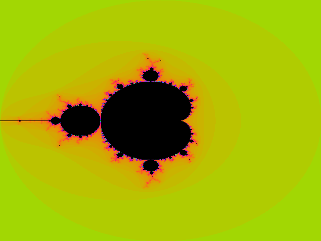

# TP 12 — Threads POSIX

## Objectifs

- créer et joindre (join) des threads POSIX ;
- implémenter un rendez-vous avec un mutex et une variable de condition, puis avec une barrière ;
- implémenter un producteur/consommateur borné avec des variables de condition ;
- adapter l'échange à trois processus à trois threads ;
- paralléliser le calcul de Mandelbrot et mesurer l'accélération.

Les threads partagent l'espace d'adressage : les données sont directement accessibles, mais toute variable mutable partagée doit être protégée. Une variable de condition s'accompagne toujours d'un mutex, et le prédicat est vérifié dans une boucle `while` (et non un `if`).

---

## 1. Rendez-vous sans barrière (`rendezvous_sem`)

```c
lock(mutex);
generation = state->generation;
state->arrived++;
if (state->arrived == parties) {
    state->arrived = 0;
    state->generation++;
    broadcast(condition);
} else {
    while (generation == state->generation)
        wait(condition, mutex);
}
unlock(mutex);
```

Le compteur de génération évite le bug classique où un thread rapide arrive pour le tour suivant et est réveillé par la diffusion du précédent. Un thread ne sort que lorsque la génération qu'il a observée a changé, ce qui signifie que le dernier participant de son tour est arrivé.

`parties` est passé sur la ligne de commande ; le même programme fonctionne pour n'importe quel nombre de threads.

---

## 2. Rendez-vous avec barrière (`rendezvous_barrier`)

`pthread_barrier_t` implémente exactement la même sémantique : chaque thread appelle `pthread_barrier_wait` et se bloque jusqu'à ce que les `parties` threads soient arrivés. La barrière est initialisée avec le nombre de participants et détruite après les jointures.

Les deux versions produisent le même ordre de sortie : chaque ligne `avant` est affichée avant toute ligne `après`.

---

## 3. Producteur/consommateur (`prodcons`)

Le tampon partagé est un tableau circulaire de `capacity` entiers. Trois objets de synchronisation sont utilisés :

```c
pthread_mutex_t mutex;
pthread_cond_t not_empty;
pthread_cond_t not_full;
```

- un producteur attend tant que `count == capacity`, écrit à `tail`, signale `not_empty` ;
- un consommateur attend tant que `count == 0` **et** qu'un producteur tourne encore, lit à `head`, signale `not_full` ;
- le dernier producteur incrémente `producers_done` et diffuse `not_empty`, ce qui permet à chaque consommateur de sortir une fois le tampon vide.

L'ordre FIFO découle des indices circulaires. Avec 4 producteurs, 3 consommateurs, une capacité de 2 et 25 éléments par producteur, exactement 100 éléments sont produits et consommés.

---

## 4. Échange de valeurs entre threads (`echange`)

Le protocole est le même qu'au TP 10, mais les trois tableaux et les trois cellules sont dans le même espace d'adressage :

- T1 écrit son maximum dans la cellule 0 et fait un post sur `p1_ready` ;
- T2 écrit son minimum dans la cellule 1 et fait un post sur `p2_ready` ;
- T0 attend les deux, échange les cellules (ou met la cellule 2 à `-1`), et fait un post sur **un sémaphore de réponse distinct par thread**.

Utiliser deux sémaphores de réponse est important : avec un seul sémaphore compteur posté deux fois, un thread pourrait consommer les deux jetons et lire une cellule qu'il a déjà écrasée, ce qui casse le protocole. Avec `p0_to_p1` et `p0_to_p2`, chaque thread reçoit exactement une réponse par tour.

Les tableaux initiaux sont `{20..90}` et `{1..8}` ; après huit échanges, T1 détient `{1..8}` et T2 détient `{20..90}`.

---

## 5. Mandelbrot (`fractale`)

L'image est découpée par lignes : le thread `i` traite les lignes `i, i + N, i + 2N, ...`. Chaque thread appelle la fonction `calcul(x, y, pixel)` inchangée ; deux threads n'écrivent jamais le même pixel, donc aucun verrou n'est nécessaire. Le seul état partagé est le tampon d'image, écrit à des décalages disjoints.

Le programme affiche la taille, le nombre de threads et le temps d'horloge murale. Sur une machine typique, l'exécution de l'image 800×600 avec 4 threads est environ trois à quatre fois plus rapide qu'avec 1 thread, selon le nombre de cœurs et la quantité de pixels noirs (coûteux).



La sortie est déterministe : les images à 1 thread et à 4 threads sont identiques octet pour octet, ce que la suite de tests vérifie.

---

## Compilation, exécution et tests

```bash
make -C tp12
./tp12/bin/rendezvous_sem 5
./tp12/bin/rendezvous_barrier 5
./tp12/bin/prodcons 4 3 2 25
./tp12/bin/echange
./tp12/bin/fractale 1 800 600 one.ppm
./tp12/bin/fractale 4 800 600 four.ppm
python3 -m pytest tests/test_tp12.py -q
```

Les tests vérifient l'ordre de la barrière, le nombre exact d'éléments produits et consommés, la séparation des deux tableaux, et l'égalité des images Mandelbrot mono- et multi-thread.
